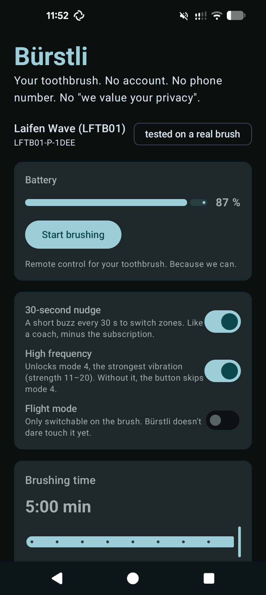

# Bürstli 🪥

**Open-source Android app for Bluetooth toothbrushes. No account. No internet permission. No nonsense.**

Starting with the Laifen Wave. More brushes welcome — see [Supported brushes](#supported-brushes).

<p align="center">
  
</p>

The official app wants you to register with an e-mail address or phone number and confirm a
verification code. To adjust a toothbrush. Bürstli doesn't. It talks to your brush over
Bluetooth, and that's it — the app doesn't even have the permission to access the internet.

> *Bürstli* is Swiss German for "little brush". Rhymes with *Brötli*. Pronounce it however you like.

## Supported brushes

| Brand | Model | Bluetooth name | Status | Features |
|---|---|---|---|---|
| Laifen | Wave (LFTB01) | `LFTB01-…` except `-SE`, `-C` | ✅ tested on a real brush | battery, modes, edit and switch modes, brushing time, 30-second nudge, high frequency, start/stop, flight mode, firmware version |
| Laifen | Wave Pro (LFTB02) | `LFTB02-S-…` | 🧪 experimental, listens only | battery, brushing time, brushing/idle, pressure warning, 30-second nudge, high frequency, flight mode, Pro features (shown) |
| Laifen | Wave SE (LFTB01-SE) | `LFTB01-SE…` | 🧪 experimental, listens only | battery, modes, brushing time, brushing/idle, 30-second nudge, high frequency, flight mode (shown) |
| Laifen | Kids TC51 (LFTB01-C) | `LFTB01-C…` | 🧪 experimental, listens only | battery, brushing time, brushing/idle, child lock, 30-second nudge, high frequency, flight mode, ramp-up, spin dry, pressure warning (shown) |
| Oclean | X series (X, X Pro, X Ultra, X Pro Elite, X Pro Digital, …), Z1 | `Oclean…` | 🧪 experimental, read-only; other Oclean models: model and battery only | model, firmware, battery, brushing history with time brushed and score ([notes](docs/OCLEAN.md)) |
| Xiaomi | Mi Smart Electric Toothbrush T500 | MiBeacon product id | 🧪 experimental, listens only; the brush must have been set up with Mi Home once | brushing/off, score of the last session, battery level, brush head wear ([notes](docs/XIAOMI.md)) |
| Xiaomi | T700, T700i, T501 | MiBeacon product id | 🧪 experimental, listens only; they broadcast encrypted, so Bürstli needs the brush's key ([how to get it](docs/XIAOMI.md#bindkey)) | brushing/off, score of the last session, and whatever else the brush broadcasts |
| Xiaomi | Pro models, kids, partner brands in Mi Home (21 more models) | MiBeacon product id | 🔍 recognized, not supported yet (most broadcast encrypted) ([notes](docs/XIAOMI.md)) | |
| Philips | Sonicare (classic: DiamondClean, Prestige, ExpertClean, Kids, …) | `Philips Sonicare`, `Philips OHC` | 🧪 experimental; ✅ reading confirmed on a DiamondClean 9000 (HX960X) – thanks to my awesome brother! | battery, status, mode, intensity, brushing time, brush head wear; from the official app, untested: model number, firmware, mode names per model, brushing history, live pressure, switch mode and intensity ([notes](docs/SONICARE.md)) |
| Philips | Sonicare 7100 (HX742X) | `Philips Sonicare` | 🔍 recognized, not supported yet (different protocol, "Condor"); protocol [documented](docs/SONICARE.md#condor--app) – tester wanted! | |
| Oral-B | iO, Genius, Smart, Pro, Triumph | broadcasts manufacturer data | 🧪 experimental, listens, connects briefly for what it doesn't broadcast | status, mode, brushing time, pressure, mouth area, exact iO series, battery level, brushing history, brush head reminder ([notes](docs/ORAL-B.md)) |
| Any other brush | Playbrush, usmile, Ailoria, MOVA, Tesla, … | – | ✋ pick it from the list of nearby devices | |

### Laifen Wave: the hidden fourth mode

The Wave has a fourth mode, **high frequency**, with the strongest vibration (strength 11–20
instead of 1–10). It is not part of the button's mode cycle until high frequency is switched on,
and as far as is known (laifen-toolbox's protocol notes, reviews of the official app) that is only
possible from an app – the button alone never gets you there.

In Bürstli: turn on **High frequency**, then either press the button twice to cycle
Mode 1 → 2 → 3 → 4, or tap **Use this mode** on the mode 4 card. Turning high frequency off while
mode 4 is active switches to mode 3 first, like the official app does.

### Not built yet: brushing history

The Wave remembers its brushing sessions – mode, settings, how long you brushed and how long was
set – and hands them to an app that asks. Bürstli could show them, but there's a catch: the brush
**deletes every entry once it has handed it out**, and it keeps no date. So Bürstli would have to
store the history on your phone (it stores nothing today), and every entry it fetched would be
gone for the official app.

Worth it for you? Give the [brushing history issue](../../issues?q=is%3Aissue+%22brushing+history%22)
a 👍. Enough thumbs, and it gets built.

### Testers wanted 🙋

🧪 **experimental** means: built from protocol research by others that was verified on real
brushes, or from what the official app does, but not yet tried with Bürstli. Experimental drivers
only read, they change nothing – with one exception: for Philips Sonicare, Bürstli also switches
mode and intensity and sets the brush's clock, as the official app does
([details](docs/SONICARE.md#writing)).

Got one of the brushes marked 🔍 or 🧪? You can help without any technical knowledge: open Bürstli,
tap **Find my brush**, then **Let's go**. Bürstli doesn't know your brush at all? Tap **My brush isn't
supported** and pick it from the list of Bluetooth devices nearby. Bürstli listens to your brush for about a minute –
it only reads, nothing on the brush is changed – and gives you a report to send by messenger,
e-mail or as a [GitHub issue](../../issues/new?template=new-brush.yml).

**Got an Oral-B?** Bürstli already shows a lot for it – battery, brushing history, when the brush
head is due – but all of that comes from studying the official app, and nobody has tried it on a
real brush yet. One report from an iO and one from an older Genius or Smart would settle most of
it: [what a first report should answer](docs/ORAL-B.md#to-check-on-a-real-brush).

**Got a Philips Sonicare 7100 (HX742X)?** It speaks a different protocol than the other
Sonicares ("Condor"). What the official app does with it is
[written down](docs/SONICARE.md#condor--app), and a driver could be built from it – but only with
someone who can try it. A report from your brush would be the first step: it shows whether it
answers the way the app expects.

**Got a Xiaomi?** Every toothbrush from Xiaomi Home is recognized; the T500, T700, T700i and T501
have first drivers that only listen. The T700 and T501 broadcast encrypted: with the brush's key
([how to get it](docs/XIAOMI.md#bindkey)) Bürstli can read them, and still sends nothing. Got one
with its key? Brush once, then copy the nerd log: it shows what the brush sent, decrypted. A report
from any other Xiaomi brush helps: it shows whether the brush broadcasts encrypted, and whether it
offers what Bürstli would need to read it without Mi Home. Owners of a T500: does Bürstli show
brushing, score, battery and brush head? [What a first report should answer](docs/XIAOMI.md#what-the-first-report-should-answer).

The protocols have been researched by others already, which makes a driver much more likely:
[philips_sonicare_ble](https://github.com/mtheli/philips_sonicare_ble/blob/main/docs/BLE_PROTOCOL.md),
[oralb-ble](https://github.com/Bluetooth-Devices/oralb-ble),
[xiaomi-ble](https://github.com/Bluetooth-Devices/xiaomi-ble) and, for Oclean,
[ha-oclean-integration](https://github.com/deniskie/ha-oclean-integration/blob/main/docs/BLE-PROTOCOL-REFERENCE.md).
Experimental drivers are built on that research and only read; they become "tested" once an owner
confirms them with Bürstli.

Got another brush? [CONTRIBUTING.md](CONTRIBUTING.md) explains how to add it.
The architecture is described in [docs/ARCHITECTURE.md](docs/ARCHITECTURE.md).

## Install

[](https://apps.obtainium.imranr.dev/redirect?r=obtainium://add/https://github.com/damnms/buerstli)

**Recommended: [Obtainium](https://github.com/ImranR98/Obtainium).** It installs Bürstli straight
from the GitHub releases and keeps it up to date – no store, no account. With Obtainium installed,
tap the badge above on your phone, or add `https://github.com/damnms/buerstli` by hand.

**Or by hand:** grab the APK from [Releases](../../releases) and open it on your phone. You'll have
to look for updates yourself. No Google Play Services needed either way.

Tips:
- The brush only shows up while it's awake. Pick it up before tapping *Find my brush*.
- It can only talk to one app at a time. Close the official app (or nRF Connect) first.
- After a disconnect it may take up to a minute until the brush advertises again.

## Permissions

| Permission | Why |
|---|---|
| `BLUETOOTH_SCAN`, `BLUETOOTH_CONNECT` | To find and talk to the brush (Android 12+) |
| `ACCESS_FINE_LOCATION` | Android 11 and older only — the OS requires it for Bluetooth scanning |
| `INTERNET` | **not requested** |

## Build

```sh
./gradlew test lintDebug assembleDebug
```

Releases are built by GitHub Actions when a tag `v*` is pushed. The workflow expects these
repository secrets: `KEYSTORE_BASE64`, `KEYSTORE_PASSWORD`, `KEY_ALIAS`, `KEY_PASSWORD`.

## Protocol (LFTB01)

GATT service `0xFF01`, one characteristic `0xFF02` (read, write, notify).

Status packet: `AA 0A 02 [len] [payload] [xor]`, payload = active mode index, then
4 × (strength, range, speed), flight mode flag, battery %.
After battery % and one unknown byte follows the brushing time in seconds (16 bit, big-endian).
Write mode settings: `AA 04 01 04 [mode] [strength] [range] [speed] [xor]`.
Write brushing time: `AA 05 01 02 [seconds hi] [seconds lo] [xor]`.
Flight mode: `AA 07 01 01 [01/00] [xor]`.
Firmware version: `AA 01 00 00 AB` asks; the brush also sends it on its own right after
connecting, e.g. `AA 01 02 09 02 00 08 59 04 04 03 00 03 F3` = `V2.0.8.Y44.303` (LFTB01-P).
History (not used, see above): `AA 09 00 00 A3` asks; the brush sends one `AA 09 02 [len] …`
notification per entry and deletes it. With nothing stored it answers `AA 09 02 01 00 A0`
(seen on a real LFTB01-P). Short brushing sessions are not stored at all. Entry layout as the
official app reads it: ?, number, mode (`FF` = empty), strength, range, speed, then the brushed
seconds (length 8) or set seconds, brushed seconds and two unknown bytes (length 12+).
The checksum is the XOR of all preceding bytes. Details in
[`LaifenWaveV1Codec.kt`](drivers/laifen/src/main/kotlin/io/github/damnms/buerstli/drivers/laifen/LaifenWaveV1Codec.kt),
with real captured packets in the unit tests.

## Credits

The protocol knowledge comes from earlier interoperability work, which deserves all the credit:
[UrbanTechIO/Laifen](https://github.com/UrbanTechIO/Laifen) (Home Assistant integration) and
[marc-alexis-com/laifen-toolbox](https://github.com/marc-alexis-com/laifen-toolbox) (Linux CLI), and for
Philips Sonicare [mtheli/philips_sonicare_ble](https://github.com/mtheli/philips_sonicare_ble) (Home Assistant integration, MIT),
and for Oral-B [Bluetooth-Devices/oralb-ble](https://github.com/Bluetooth-Devices/oralb-ble) (the library behind Home
Assistant's Oral-B integration, MIT), whose test suite also provides the real advertisements our tests use,
and for Xiaomi [Bluetooth-Devices/xiaomi-ble](https://github.com/Bluetooth-Devices/xiaomi-ble) (Apache-2.0) and
[custom-components/ble_monitor](https://github.com/custom-components/ble_monitor) (MIT), whose tests provide our real Xiaomi frames.
For Oral-B, Philips Sonicare and Xiaomi, the official apps were also studied to understand the protocol, see
[docs/ORAL-B.md](docs/ORAL-B.md), [docs/SONICARE.md](docs/SONICARE.md) and [docs/XIAOMI.md](docs/XIAOMI.md). No code was copied from any of them, and none from an official app.

## How this was made

Bürstli was written with the help of an AI assistant (Claude). For the Laifen Wave, the protocol
was verified step by step on a real brush, and the parser is tested against packets captured from
that brush. The Philips Sonicare driver was confirmed on a real DiamondClean 9000. Everything else
is built on other people's research or on what the official app does (see Credits), and stays
experimental until an owner confirms it.

## Legal

This is an independent interoperability project. It is not affiliated with, endorsed by or
supported by Laifen, Philips, Procter & Gamble (Oral-B), Xiaomi or Oclean. "Laifen", "Laifen Wave",
"Philips", "Sonicare", "Oral-B", "Xiaomi", "Mijia" and "Oclean" are trademarks of their respective
owners and are used here only to describe compatibility. Tools by others that the docs point to
(e.g. for a Xiaomi key) are not part of Bürstli; Bürstli has no rights or duties regarding them. Use at your own risk – worst case, your toothbrush forgets its favourite
settings.

## License

[GPL-3.0](LICENSE). Fork it, improve it, share it — but keep it open. Nobody gets to turn this
into yet another closed app that wants your phone number.
