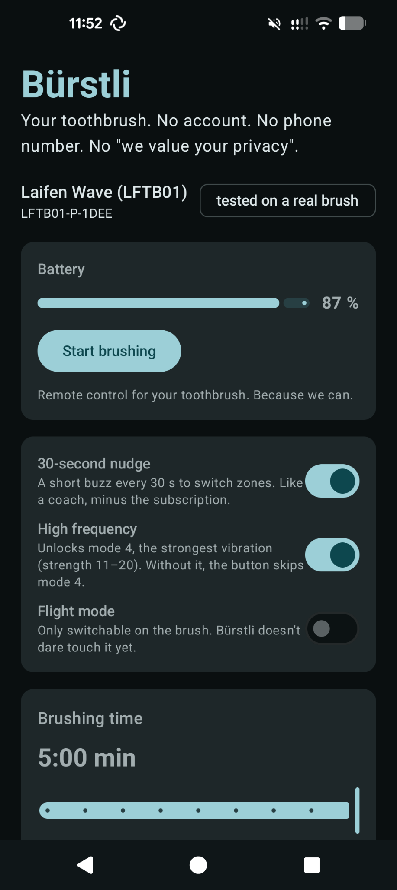

# Bürstli 🪥

**Open-source Android app for Bluetooth toothbrushes. No account. No internet permission. No nonsense.**

Starting with the Laifen Wave. More brushes welcome — see [Supported brushes](#supported-brushes).

<p align="center">
  
</p>

The official app wants you to register with an e-mail address or phone number and confirm a
verification code. To adjust a toothbrush. Bürstli doesn't. It talks to your brush over
Bluetooth, and that's it — the app doesn't even have the permission to access the internet.

> *Bürstli* is Swiss German for "little brush". Rhymes with *Brötli*. Pronounce it however you like.

## Supported brushes

| Brand | Model | Bluetooth name | Status | Features |
|---|---|---|---|---|
| Laifen | Wave (LFTB01) | `LFTB01-…` except `-SE`, `-C` | ✅ tested on a real brush | battery, modes, edit and switch modes, brushing time, 30-second nudge, high frequency, start/stop; flight mode shown |
| Laifen | Wave Pro (LFTB02) | `LFTB02-S-…` | 🧪 experimental, listens only | battery, brushing time, brushing/idle, pressure warning, Pro features (shown) |
| Laifen | SE family, kids' TC51 | `LFTB01-SE…`, `LFTB01-C…` | 🔍 recognized, not supported yet | |
| Oclean | X Pro, Z1, Y-series, … | `Oclean…` | 🔍 recognized, not supported yet | |
| Xiaomi | T500, T501, T700, T700i | MiBeacon product id | 🔍 recognized, not supported yet | |
| Any other brush | Playbrush, usmile, Ailoria, MOVA, Tesla, … | – | ✋ pick it from the list of nearby devices | |
| Philips | Sonicare (classic: DiamondClean, Prestige, ExpertClean, Kids, …) | `Philips Sonicare`, `Philips OHC` | 🧪 experimental, read-only; ✅ confirmed on a DiamondClean 9000 (HX960X) – thanks to my awesome brother! | battery, status, mode, intensity, brushing time, brush head wear (not seen on a real brush yet) |
| Philips | Sonicare 7100 (HX742X) | `Philips Sonicare` | 🔍 recognized, not supported yet (different protocol) | |
| Oral-B | iO, Genius, Smart, Pro, Triumph | broadcasts manufacturer data | 🧪 experimental, listens only (no connection) | status, mode, brushing time, pressure, mouth area – no battery level |

### Laifen Wave: the hidden fourth mode

The Wave has a fourth mode, **high frequency**, with the strongest vibration (strength 11–20
instead of 1–10). It is not part of the button's mode cycle until high frequency is switched on,
and as far as is known (laifen-toolbox's protocol notes, reviews of the official app) that is only
possible from an app – the button alone never gets you there.

In Bürstli: turn on **High frequency**, then either press the button twice to cycle
Mode 1 → 2 → 3 → 4, or tap **Use this mode** on the mode 4 card. Turning high frequency off while
mode 4 is active switches to mode 3 first, like the official app does.

### Testers wanted 🙋

🧪 **experimental** means: built from protocol research by others that was verified on real
brushes, but not yet tried with Bürstli. Experimental drivers only read, they change nothing.

Got one of the brushes marked 🔍 or 🧪? You can help without any technical knowledge: open Bürstli,
tap **Find my brush**, then **Let's go**. Bürstli doesn't know your brush at all? Tap **My brush isn't
supported** and pick it from the list of Bluetooth devices nearby. Bürstli listens to your brush for about a minute –
it only reads, nothing on the brush is changed – and gives you a report to send by messenger,
e-mail or as a [GitHub issue](../../issues/new?template=new-brush.yml).

The protocols have been researched by others already, which makes a driver much more likely:
[philips_sonicare_ble](https://github.com/mtheli/philips_sonicare_ble/blob/main/docs/BLE_PROTOCOL.md),
[oralb-ble](https://github.com/Bluetooth-Devices/oralb-ble) and, for Oclean,
[ha-oclean-integration](https://github.com/Giallo1O/ha-oclean-integration/blob/main/docs/BLE-PROTOCOL-REFERENCE.md).
Experimental drivers are built on that research and only read; they become "tested" once an owner
confirms them with Bürstli.

Got another brush? [CONTRIBUTING.md](CONTRIBUTING.md) explains how to add it.
The architecture is described in [docs/ARCHITECTURE.md](docs/ARCHITECTURE.md).

## Install

[](https://apps.obtainium.imranr.dev/redirect?r=obtainium://add/https://github.com/damnms/buerstli)

**Recommended: [Obtainium](https://github.com/ImranR98/Obtainium).** It installs Bürstli straight
from the GitHub releases and keeps it up to date – no store, no account. With Obtainium installed,
tap the badge above on your phone, or add `https://github.com/damnms/buerstli` by hand.

**Or by hand:** grab the APK from [Releases](../../releases) and open it on your phone. You'll have
to look for updates yourself. No Google Play Services needed either way.

Tips:
- The brush only shows up while it's awake. Pick it up before tapping *Find my brush*.
- It can only talk to one app at a time. Close the official app (or nRF Connect) first.
- After a disconnect it may take up to a minute until the brush advertises again.

## Permissions

| Permission | Why |
|---|---|
| `BLUETOOTH_SCAN`, `BLUETOOTH_CONNECT` | To find and talk to the brush (Android 12+) |
| `ACCESS_FINE_LOCATION` | Android 11 and older only — the OS requires it for Bluetooth scanning |
| `INTERNET` | **not requested** |

## Build

```sh
./gradlew test lintDebug assembleDebug
```

Releases are built by GitHub Actions when a tag `v*` is pushed. The workflow expects these
repository secrets: `KEYSTORE_BASE64`, `KEYSTORE_PASSWORD`, `KEY_ALIAS`, `KEY_PASSWORD`.

## Protocol (LFTB01)

GATT service `0xFF01`, one characteristic `0xFF02` (read, write, notify).

Status packet: `AA 0A 02 [len] [payload] [xor]`, payload = active mode index, then
4 × (strength, range, speed), flight mode flag, battery %.
After battery % and one unknown byte follows the brushing time in seconds (16 bit, big-endian).
Write mode settings: `AA 04 01 04 [mode] [strength] [range] [speed] [xor]`.
Write brushing time: `AA 05 01 02 [seconds hi] [seconds lo] [xor]`.
The checksum is the XOR of all preceding bytes. Details in
[`LaifenWaveV1Codec.kt`](drivers/laifen/src/main/kotlin/io/github/damnms/buerstli/drivers/laifen/LaifenWaveV1Codec.kt),
with real captured packets in the unit tests.

## Credits

The protocol knowledge comes from earlier interoperability work, which deserves all the credit:
[UrbanTechIO/Laifen](https://github.com/UrbanTechIO/Laifen) (Home Assistant integration) and
[marc-alexis-com/laifen-toolbox](https://github.com/marc-alexis-com/laifen-toolbox) (Linux CLI), and for
Philips Sonicare [mtheli/philips_sonicare_ble](https://github.com/mtheli/philips_sonicare_ble) (Home Assistant integration, MIT),
and for Oral-B [Bluetooth-Devices/oralb-ble](https://github.com/Bluetooth-Devices/oralb-ble) (the library behind Home
Assistant's Oral-B integration, MIT), whose test suite also provides the real advertisements our tests use.
No code was copied from either, and none from the official app.

## How this was made

Bürstli was written with the help of an AI assistant (Claude). The protocol was verified step by
step on a real brush, and the parser is tested against packets captured from that brush.

## Legal

This is an independent interoperability project. It is not affiliated with, endorsed by or
supported by Laifen, Philips or Procter & Gamble (Oral-B). "Laifen", "Laifen Wave", "Philips",
"Sonicare" and "Oral-B" are trademarks of their respective owners and are used here only to
describe compatibility. Use at your own risk – worst case, your toothbrush forgets its favourite
settings.

## License

[GPL-3.0](LICENSE). Fork it, improve it, share it — but keep it open. Nobody gets to turn this
into yet another closed app that wants your phone number.
